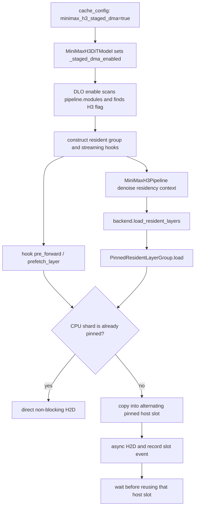

# Pinned-memory DMA: DLO call path and 480×320 check

## Correct invocation path

The earlier weight-loader hook was not the path used by this run: with DLO, MiniMax-H3 parameters remain on CPU while DLO owns the host shards. The live transfer path is:

The resident path runs immediately before the denoise loop. The streamed-layer path enters through the DLO hook's `prefetch_layer`. The opt-in now reaches both paths. `PinnedDMA/h2d_direct` and `PinnedDMA/stage_to_pinned` profiler ranges make the selected path visible in the trace.

## What profiling showed

The baseline already sends pinned CPU shards directly to the GPU. `DistributedLayerwiseOffloadHook._shard_and_pin` creates pinned CPU shards when `pin_cpu_memory=True`; the first implementation copied those shards into a second pinned allocation before sending them to the GPU. That copy was redundant.

PyTorch Profiler captured CPU and CUDA activities around `DistributedLayerwiseOffloadBackend.load_resident_layers` for all eight ranks. Each rank transferred 16.14 GB in 50 H2D copies in all three captures. The unconditional staging probe added 50 host staging ranges and increased aggregate CPU `aten::copy_` time from about 0.8 ms to 3.63 s per rank, while H2D time stayed near 0.5 s. The corrected path skips the duplicate staging copy for pinned sources and retains two-slot staging for pageable or rank-local mmap sources.

| Capture | Custom H2D ranges/rank | Staging ranges/rank | H2D copies/rank | H2D GB/rank | H2D time sum (ms/rank) | CPU `aten::copy_` sum (ms/rank) | DLO host range (ms/rank) |
|---|---:|---:|---:|---:|---:|---:|---:|
| Clean baseline | 0 | 0 | 50 | 16.14 | 516.9 | 0.8 | 58.6 |
| Initial unconditional-stage probe | 50 | 50 | 50 | 16.14 | 536.4 | 3633.8 | 3742.0 |
| Corrected pinned-direct path | 50 | 0 | 50 | 16.14 | 502.2 | 0.8 | 47.9 |

The CPU `aten::copy_` aggregate includes CPU copy and launch work; it is not GPU time. H2D values are summed event durations and may overlap CPU work. These are path diagnostics from one capture per variant, not a statistical speedup benchmark.

## 480×320 generation

All runs used the same Ref2VA checkpoint, prompt, reference image, seed 1101, 50 steps, 124 frames, 24 fps, TP4 × USP2, eight RTX 5090s, and two 2-step warmups. All three MP4 files are byte-identical, with SHA-256 `f96bd3292697348adb2c9619957f241630052e8415b03c88567592256d3f0aca`; `ffprobe` reports H.264, 480×320, 124 frames, 24 fps, 5.166667 seconds.

| Run | Denoise (slowest rank) | Client E2E | Interpretation |
|---|---:|---:|---|
| Clean baseline, profiled pair | 41.149 s | 47.182 s | Single capture/run |
| Initial unconditional-stage probe | 77.392 s | 84.633 s | Includes the redundant CPU staging copy |
| Corrected pinned-direct path | 48.070 s | 54.109 s | Single capture/run; matches the profiled direct path |
| Prior adopted baseline mean | 50.798 s | 56.876 s | Mean of three baseline retests |

The corrected run is 5.4% below the adopted denoise mean and 4.9% below the adopted E2E mean, but 16.8% and 14.7% above the contemporaneous single-run baseline. The prior baseline retests also varied substantially. The evidence confirms correct dispatch and avoids the added CPU copies; it does not establish a speedup over direct pinned H2D.

## Checks and artifacts

- Focused DLO tests: 5 passed, including alternating pageable staging slots and direct transfer for already-pinned shards.
- Pinned-DMA model-loader tests: 6 passed.
- Python compile and `git diff --check`: passed.
- The wider DLO module was also attempted earlier; its remaining failures were from unavailable `pytest-mock` fixtures and teardown calls unsupported by the CPU-only test container.
- Traces are PyTorch Profiler Chrome JSON (CPU + CUDA), readable in Perfetto or TensorBoard Profiler. The capture is scoped to the actual DLO resident load, rather than process startup.

Files:

- Profile summary and chart: [dlo-dma-profile-summary.md](../profiling/pinned-dma-dlo-comparison/dlo-dma-profile-summary.md), [dlo-dma-profile.svg](../profiling/pinned-dma-dlo-comparison/dlo-dma-profile.svg)
- Baseline output and profile: [baseline MP4](../pinned-dma-dlo-transfer-profile-baseline-480x320/480x320/output-01.mp4), [rank 0 Chrome trace](../pinned-dma-dlo-transfer-profile-baseline-480x320/dlo-load-profile/resident-load-rank0-pid1672.json)
- Initial staging probe: [MP4](../pinned-dma-dlo-transfer-profile-unconditional-stage-480x320/480x320/output-01.mp4), [rank 0 Chrome trace](../pinned-dma-dlo-transfer-profile-unconditional-stage-480x320/dlo-load-profile/resident-load-rank0-pid1668.json)
- Corrected pinned-direct run: [MP4](../pinned-dma-dlo-transfer-profile-480x320/480x320/output-01.mp4), [rank 0 Chrome trace](../pinned-dma-dlo-transfer-profile-480x320/dlo-load-profile/resident-load-rank0-pid1674.json)
